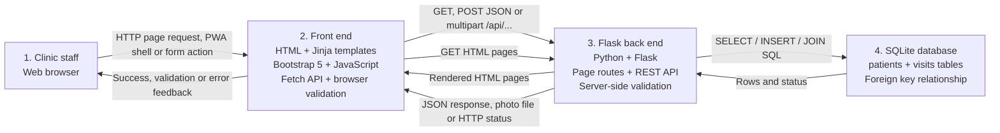

# PawCare Architecture and Request Flow

## Architecture diagram

The browser is the presentation and interaction environment; HTML, Bootstrap and JavaScript form the front end. Flask renders the web pages and exposes the REST API. SQLite provides persistent storage through parameterized SQL.

## PWA, API and file-storage request flow

- The browser registers `/sw.js` and installs the manifest at `/manifest.webmanifest`. Static application-shell assets are cached; navigation is cached with an offline fallback, and `/api/*` requests are intentionally not cached.
- JavaScript calls `GET /api/reports/summary` and uses the returned patient, visit, today's visit and open-case counts for dashboard cards.
- Patient photo uploads use `multipart/form-data` at `POST /api/uploads`. Flask verifies MIME type, extension, binary signature and size before saving a UUID filename under the Flask instance upload directory.
- The generated filename is sent with the patient JSON and stored in SQLite's `photo_path` column. `GET /api/patients/<id>/photo` resolves the patient record to the file and serves it only if the stored filename is safe and exists.
- Mutating requests include the session CSRF token. Flask also adds security headers and applies HTTPS/HSTS/Secure/Cookie settings when HTTPS mode is enabled.

## Save-patient request flow

1. **Staff submits the form.** The staff member enters patient and owner details in the Add Patient page.
2. **Browser validation runs.** `validation.js` and `patient-form.js` check the values and show field-level feedback. If validation fails, JavaScript does not send the request.
3. **The front end calls the API.** After validation succeeds, `api.js` sends a JSON `POST /api/patients` request with the patient data.
4. **Flask validates the request.** `app.py` normalizes the phone number, calls `validate_patient()`, and rejects malformed data with HTTP `400` or a duplicate pet-owner combination with HTTP `409`.
5. **Flask writes to SQLite.** Valid data is inserted with parameterized SQL into the `patients` table. The database also enforces its unique pet-and-email index.
6. **Flask returns the result.** A successful insert returns HTTP `201` and the created patient; validation or database errors return JSON error details and an appropriate status.
7. **The front end updates the staff member.** The page shows a success, warning, field-error or general error message without reloading the page.

## Read-page and report flow

1. The browser requests `/`, `/directory`, `/visits`, or `/reports`.
2. A Flask page route calls the relevant query helper in `app.py`.
3. Flask executes `SELECT` queries against SQLite.
4. SQLite returns patient, visit, and optional report rows.
5. Flask renders a Jinja template and returns HTML.
6. JavaScript may then call `GET /api/patients`, `GET /api/visits`, or `GET /api/reports/monthly` for dynamic directory, visit and report updates.

## Key responsibilities

| Component | Technology | Responsibility |
|---|---|---|
| 1. Staff and browser | HTML forms and browser APIs | User interaction, navigation, immediate feedback and Fetch requests |
| 2. Front end | Jinja HTML, Bootstrap 5, JavaScript modules | Presentation, client validation, API calls and response handling |
| 3. Flask back end | Python 3 and Flask | Page rendering, REST routes, server validation and database coordination |
| 4. SQLite database | SQLite 3 | Persistent patients and visits data, relationships and constraints |
