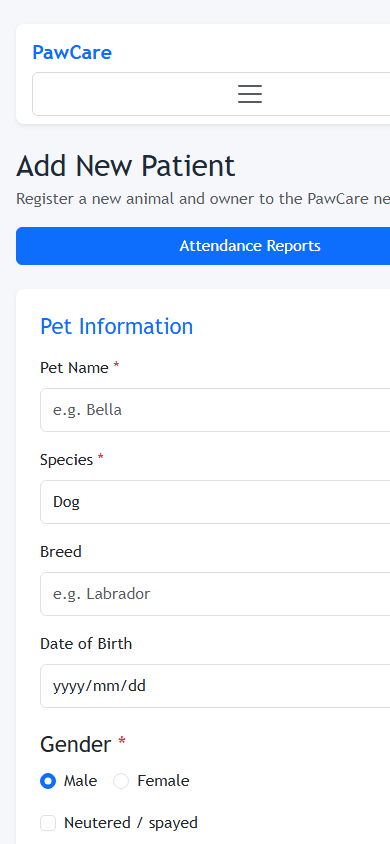
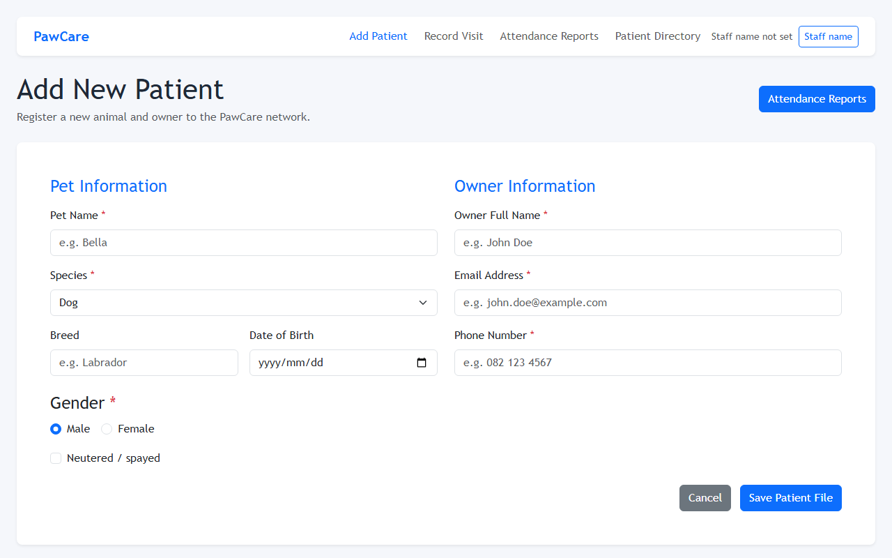

# C2: Usability and Efficiency Across Devices

## Device test matrix

| Device/test environment | Browser | Screen width | Area tested | Problem found | Fix |
|---|---|---:|---|---|---|
| Mobile browser emulation | Chrome mobile mode, Lighthouse | 390 px | Patient form, navigation, touch targets, offline status | Form actions and staff controls could be difficult to reach; mobile controls were not consistently 44 px high | Added a 44 px minimum height for mobile controls, full-width mobile buttons, mobile navigation spacing, and an offline status banner |
| Desktop/laptop browser | Chrome 1280 | 1280 px | Shared layout, multi-column forms, reports, navigation | Layout remained useful, but mobile rules did not reduce wide layouts incorrectly | Kept column layouts at desktop widths and limited full-width behavior to the 575 px mobile breakpoint |

The responsive implementation uses the existing Bootstrap grid and the PawCare mobile breakpoint. Validation, keyboard focus, horizontal table scrolling, reduced-motion behavior, and the connection warning were checked alongside the layouts.

## Lighthouse mobile audit

Audit URL: `http://127.0.0.1:5000/`  
Mode: Chrome Lighthouse mobile emulation  
Run date: 2026-11-03

| Category | Score |
|---|---:|
| Performance | 92 |
| Accessibility | 100 |
| Best Practices | 100 |
| SEO | 90 |

The machine-readable Lighthouse result is stored in [lighthouse-mobile.json](lighthouse-mobile.json).

## Data-saving changes

1. **Cache the application shell with a service worker:** Bootstrap CSS, core JavaScript, page scripts and icons are cached after the first successful load. This avoids downloading unchanged assets on repeat clinic visits and keeps useful pages available after connectivity loss.
2. **Load page-specific libraries only on their page:** React is loaded by the Patient Directory template, while Chart.js is loaded only by the Attendance Reports template. This prevents the Add Patient and Record Visit pages from downloading library data they do not use.
3. **Serve minified production assets and reuse browser caching:** PawCare uses Bootstrap's minified CSS/JavaScript and compressed, small PWA icons. Service-worker caching also lets a returning browser reuse these static assets instead of repeatedly transferring them over prepaid mobile data.
